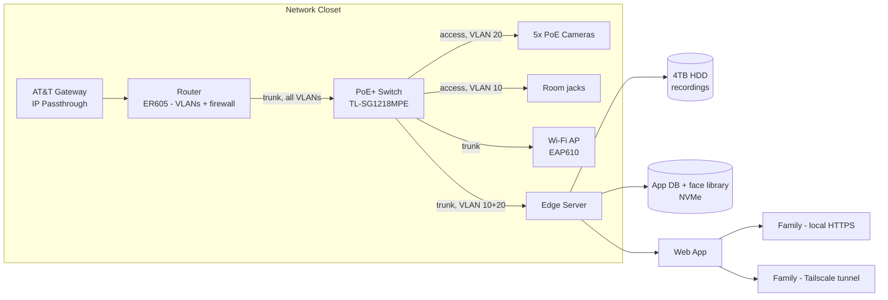
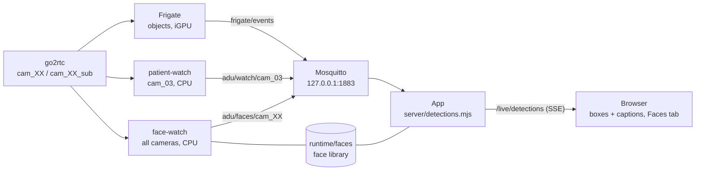

# ADU Smart System

A local-first security, networking, and smart-home platform for accessory dwelling units. Built for a family ADU first; designed to be repeatable for other homeowners and builders later.

## Status

**Running today** on the edge server (an Intel N95 Ubuntu mini PC), before the surveillance HDD is installed:

- **The web app**: live camera grid, on-demand recordings, camera settings, accounts with admin and viewer roles, and HTTPS access over Tailscale. It runs as a systemd user service next to a native go2rtc.
- **The detection stack** (`docker-compose.detect.yml`):
  - Frigate object detection on the iGPU, which puts live captions over each camera.
  - MQTT.
  - The **patient monitor** on camera 03: hand gestures, and "patient left the zone" or "out of view".
  - **Face recognition** on every camera, managed in the app's **Faces** tab.

**Not yet running:** 24/7 recording and the production stack (`docker-compose.yml`) need the HDD. The patient monitor and face recognition are prototypes; see [Known issues](#known-issues).

[docs/deployment.md](docs/deployment.md) is authoritative for commands and configuration. It covers development, the edge box, production, remote access and health checks. The plan for growing this into a home automation platform is in [home automation architecture](docs/home-automation-architecture.md).

## Table of contents

- [Status](#status)
- [Features](#features)
- [Goals](#goals)
- [Phases](#phases)
- [Hardware](#hardware)
- [Network design](#network-design)
- [Software stack](#software-stack)
- [Architecture](#architecture)
- [Repo structure](#repo-structure)
- [Development](#development)
- [Running the stacks (Makefile)](#running-the-stacks-makefile)
- [Getting started on the edge server](#getting-started-on-the-edge-server)
- [Requirements](#requirements)
- [Known issues](#known-issues)
- [Open items](#open-items)

## Features

| Area | What it does |
|---|---|
| **Live view** | A grid of every camera's sub-stream. Click a tile for the full-quality stream; Esc closes it. Browsers that can't decode H.265 get an H.264 transcode automatically. |
| **Live captions** | Boxes and short captions over the video. Frigate's objects ("Person walking toward camera") on every camera; patient-monitor captions on camera 03; face labels on every camera. |
| **Patient monitor** (camera 03) | "Waving - may need help", "Hand raised", held hand signs, "Patient moving / still", and "Patient left the zone" or "Patient out of view" after 5 s. A separate person detector confirms every patient box, so an empty chair or a mouse on the desk is never a "patient". Captions only: no notifications, not a nurse call. |
| **Face recognition** | Faces on every camera are labelled with a name or an ID (`face_0003`). An unknown face gets a new ID after a few clear views. |
| **Faces tab** | Browse every ID with its photos and last sighting; name IDs; delete single photos, one, several or all faces; merge likely duplicates. Viewers browse; changes need an admin. |
| **Recordings** | On-demand MP4 recording per camera, with the live captions saved alongside. Play, download (optionally with captions drawn in) and delete. A Frigate history timeline and time-range downloads appear once Frigate records (production). |
| **Camera settings** | Date/time, day/night, image, WDR, backlight and flip over ONVIF, per camera or all at once. |
| **Accounts** | Owner setup on first run (no default password), admin and viewer roles, 12-hour sessions, same-origin and rate-limit protections. |

## Goals

- **Local-first.** Recording, playback, and core function keep working with the internet down.
- **Vendor-neutral.** Ethernet, PoE, RTSP, and ONVIF — cameras and servers can be swapped without rework.
- **Secure by default.** Cameras have no route to the internet. Remote users reach the app, never a camera.
- **One app.** No vendor apps, no separate NVR UI for daily use.
- **Repeatable.** Standard hardware classes and one install sequence that another ADU can reuse.

## Phases

| Phase | What ships | Status |
|---|---|---|
| v1 — Hardware & recording | 5 cameras recording 24/7, VLANs, Frigate, remote viewing via tunnel, UPS, health alerts. | In progress. Cameras and the edge server are live; 24/7 recording waits for the HDD. Task breakdown: [`docs/v1-tasks.md`](docs/v1-tasks.md) |
| v2 — Homeowner app | Node + Next.js web app (SQLite): accounts, live grid, recordings, timeline, clip export, camera settings, TV-browser support. | Built and in use on the edge box. Production acceptance (Frigate timeline, HDD recordings) pending |
| v3 — Expansion | Object detection, sensor integrations (smoke/CO/gas/flood/door/stove, air quality, appliances) via Home Assistant, alerting, TV dashboard, off-site backup, installer image. See [`docs/home-automation-architecture.md`](docs/home-automation-architecture.md). | Started: live object captions (OpenVINO), patient monitor and face recognition prototypes. Sensors and alerting planned |

## Hardware

| Component | Spec | Notes |
|---|---|---|
| Cameras | 5x Anpviz IPC-D3243W-S, 4MP PoE, ONVIF/RTSP | H.265 main stream, H.264 sub-stream |
| Cabling | Cat6A F/UTP shielded, 9 runs (5 camera, 4 room) | Shielded end-to-end: jacks, plugs, patch panel |
| PoE switch | TP-Link TL-SG1016PE, 16 gigabit ports, 8 PoE+ | 802.1Q VLAN tagging, 150W PoE budget |
| Router | TP-Link Omada ER605 | VLANs, inter-VLAN firewall/ACLs |
| Access point | TP-Link Omada EAP610 | WiFi 6, SSID-to-VLAN mapping |
| Edge server | N100/N95-class mini PC, 16GB RAM, 512GB NVMe | Runs Frigate + backend; Quick Sync decode, OpenVINO-ready for v3 AI |
| Storage | 4TB surveillance HDD, USB 3 dock | Separate volume from app data and any future family/IoT storage |
| Enclosure | 6U wall cabinet w/ thermostat fan | Patch panel (U1), switch (U2), shelf for router + mini PC (U3-U4) |
| UPS | 1000-1500VA, line-interactive | Feeds every device in the cabinet |

Full purchase ledger and pricing lives outside this repo (project tracking doc).

## Network design

Four VLANs, enforced at the router:

| VLAN | Purpose | Internet? | Reaches |
|---|---|---|---|
| 10 — Trusted | Family devices, server management | Yes | Everything (via the app; never direct to cameras/IoT) |
| 20 — Cameras | Cameras + server's camera-facing interface | No | Server only, on RTSP/ONVIF ports |
| 30 — IoT | Future sensors, smart TVs | Yes | Internet + server's MQTT/API ports only |
| 40 — Guest | Short-term guests | Yes | Internet only, fully isolated |

**Rule that never changes:** no port forwarded from the internet to any camera, admin page, SSH, or database. Remote users reach the app only, via a tunnel.

See [`docs/firewall-matrix.md`](docs/firewall-matrix.md) for the full source/destination rule table.

## Software stack

| Layer | Tool | License | Job |
|---|---|---|---|
| OS / containers | Ubuntu (Debian-based) + Docker Compose, `make` | Open source | Host + repeatable deploys |
| NVR | Frigate 0.18 (+ bundled go2rtc) | MIT | RTSP ingest, recording (production), object detection |
| Streams | go2rtc | MIT | Camera relay and on-demand H.264 transcode for the browser |
| Object detection | OpenVINO (in Frigate) on the iGPU | Apache-2.0 | Person/vehicle detection for live captions |
| Patient monitor | MediaPipe Pose + Gesture Recognizer, EfficientDet-Lite2 | Apache-2.0 | Body, hands and person confirmation on camera 03 (CPU) |
| Face recognition | OpenCV YuNet (detector) + SFace (embeddings) | MIT / Apache-2.0 | Faces on every camera (CPU) |
| Messaging | Mosquitto (MQTT) | EPL/EDL | Frigate events and caption feeds now; sensors in v3 |
| App | Node server + Next.js / React, SQLite (`node:sqlite`) | MIT / Public domain | Accounts, live view, recordings, captions, Faces tab |
| Remote access | Tailscale Serve | Free tier | HTTPS to the app over an encrypted tunnel, no open ports |
| Device hub (v3) | Home Assistant Core + Zigbee2MQTT | Apache-2.0 / GPL-3.0 (separate process) | Sensor and appliance integrations, safety automations |
| Health | `deploy/health-check.py` timer; smartmontools, NUT, Uptime Kuma planned | GPL / MIT | Disk, UPS, and service alerts |
| Time | chrony | GPL | NTP for cameras with no internet route |
| Backup (v3) | restic | BSD | Optional encrypted off-site clip backup |

> **License note:** GPL tools above are used as unmodified, separate processes (monitoring/NTP), which is compliant even in a commercial product. Anything we fork, modify, or statically link must stay BSD/MIT/Apache — that's the line for a distributable product image.

## Architecture



**Video path:** camera encodes H.265 → switch (VLAN 20, untagged) → edge server → go2rtc relays it (and transcodes to H.264 only for browsers that need it) → the app serves it to signed-in browsers over its own WebSocket. In production Frigate also records the main stream to the HDD. Browsers never reach a camera or raw RTSP.

**Caption path:** the analysis services read the small sub-streams from go2rtc and publish over MQTT on the server. The app merges their output and pushes it to the browser with the video.



## Repo structure

```
.
├── README.md                    # this file
├── Makefile                     # make build|up|down|clean|ps [STACK=dev|detect|prod]
├── docker-compose.yml           # production (needs the HDD): Frigate recording, app, MQTT, patient-watch, face-watch
├── docker-compose.detect.yml    # edge box until the HDD is in: Frigate detection, MQTT, patient-watch, face-watch
├── docker-compose.dev.yml       # dev stack, no cameras needed: go2rtc (demo clip), MQTT, Frigate, patient-watch, face-watch
├── docker-compose.remote-mac.yml  # temporary outbound tunnel (deploy/railway-gateway)
├── frontend/                    # Node server + Next.js app: live view, recordings, captions, Faces tab, accounts
├── patient-watch/               # patient monitor for cam_03 (+ record.py, replay.py, evaluate.py)
├── face-watch/                  # face recognition on every camera (+ manage.py, evaluate.py)
├── go2rtc/
│   ├── go2rtc.yaml              # real camera streams (credentials come from .env)
│   └── go2rtc.demo.yaml         # demo streams: a recorded clip looped as cam_03
├── frigate-detect/              # detection-only Frigate config + Mosquitto config (database gitignored)
├── demo/                        # demo clip builder + dev Frigate config (the clip itself is gitignored)
├── deploy/                      # systemd units, HDD mount check, health check, Frigate config generator, compose-ps.sh
├── docs/
│   ├── deployment.md            # authoritative setup and operations guide
│   ├── home-automation-architecture.md  # single-pane-of-glass plan
│   ├── firewall-matrix.md       # full VLAN source/destination rules
│   ├── v1-tasks.md              # v1 install plan
│   └── frigate-config.example.yml
├── frigate/config.yml           # production Frigate config (gitignored: has credentials)
└── runtime/                     # per-install data, gitignored: app data, face library
```

Never committed: `.env` (camera credentials), `frigate/config.yml`, Frigate databases, `runtime/` (app data and the face library), demo footage. See `.gitignore`.

## Development

The dev stack runs everything without a camera, edge server or HDD. By default go2rtc loops a recorded clip as camera 03, so live captions, the patient monitor and face recognition run on known footage.

```sh
make up                         # dev stack; builds demo/media/cam_03.mp4 from ~/patient-watch-recordings/rec1 the first time
cd frontend && npm install && FACES_DIR=../runtime/faces-dev npm run dev
```

Open http://localhost:3000/setup to create the owner account, then http://localhost:3000. To use the real cameras instead (laptop on the camera network): `cp .env.example .env`, fill in `CAM_USER` / `CAM_PASSWORD` / `CAMxx_HOST`, and start with `GO2RTC_CONFIG=go2rtc.yaml make up`. To add a camera, add `cam_XX` (main, `/stream0`) and `cam_XX_sub` (sub, `/stream1`) to `go2rtc/go2rtc.yaml` with `#backchannel=0`; the grid picks it up automatically. Details, including running the dev stack next to the live one on the edge box: [deployment.md](docs/deployment.md#development-no-cameras-needed).

Tests: `cd frontend && npm test` for the app. The patient-watch and face-watch unit tests run on every image build (`make build`).

## Running the stacks (Makefile)

| Command | What it does |
|---|---|
| `make` | List the targets |
| `make build` | Build the stack's own images (patient-watch, face-watch; the app in production) |
| `make up` | Start the stack in the background, building what's missing |
| `make down` | Stop and remove the stack's containers |
| `make clean` | `down`, plus remove the stack's built images, networks and anonymous volumes |
| `make ps` | Show this orchestration's containers, running or stopped (every stack, or only `STACK=...`), plus the native services on the edge box |

Choose the stack with `STACK=dev` (default), `STACK=detect` (the edge box today) or `STACK=prod`. Act on some services only with `SERVICES="face-watch patient-watch"`. Production `up`/`down` go through systemd, so the HDD mount check always runs. **No target deletes data**: the face library, app data, recordings, Frigate config and demo clip live in host folders.

## Getting started on the edge server

1. Install Ubuntu and Docker + Docker Compose; disable onboard Wi-Fi (the server is reached over its wired VLAN interfaces only).
2. Configure the router (ER605) VLANs and firewall rules per [firewall-matrix.md](docs/firewall-matrix.md), and the AP (EAP610) SSID-to-VLAN mapping.
3. Fill the root `.env` with camera credentials and addresses (see `.env.example`).
4. Before the HDD: run the detection stack and the native app as described in [deployment.md: edge box today](docs/deployment.md#edge-box-today-detection-stack).
5. With the HDD: follow [deployment.md: Ubuntu production](docs/deployment.md#ubuntu-production). It mounts and checks the HDD, generates `frigate/config.yml`, then `make build STACK=prod` and `make up STACK=prod`.
6. Confirm every camera records and plays back before relying on it, then set up [remote access](docs/deployment.md#private-remote-access) and [health alerts](docs/deployment.md#health-and-recovery).

## Requirements

**Functional**
- 24/7 local recording from 5 cameras, minimum 1 week retention (current 4TB config: ~16 days at expected bitrate).
- Recording and local playback continue with no internet connection.
- One responsive web UI usable from phone, laptop, and smart TV browsers.
- Remote access via encrypted tunnel only — no exposed ports.
- Health alerts: camera offline, disk failing/full, UPS on battery, cabinet over-temperature, server down.

**Non-functional**
- All commercial-product code/dependencies must be BSD/MIT/Apache licensed (see license note above).
- Storage volumes for surveillance, app data, and future family/IoT data must be separate, each with independent retention.
- Server API must be extensible for future sensors (smoke/CO, gas, flood, door lock, stove) without a redesign.

## Known issues

- **Frigate decode crashes (detection stack):** with `preset-vaapi`, each camera's decoder crashes about every 1–2 minutes ("Failed to sync surface") and restarts. Live captions blink during restarts. Candidate fix: `preset-intel-qsv-h265` or software decode for the small sub-streams.
- **CPU headroom:** the N95 is about 85–90% busy with the patient monitor (about 1.4 cores) and face recognition at 2 fps per camera (about 0.5 core). Raise `FACE_FPS` only with care.
- **Patient monitor:** a real wave in front of the backlit window was missed on the test recording; leaving the chair is detected reliably. Night (IR) recognition with a patient present is untested.
- **Face recognition:** tested on one person only (1 ID, 99% labelled once known). Not yet tested with two or more people or at night. It only reaches faces within a few metres (about 32 px wide in the 640x360 sub-stream). The face library is biometric data; see the privacy notes in [deployment.md](docs/deployment.md#face-recognition-prototype).
- **Next.js advisory:** `next build` reports a known security vulnerability in the installed Next.js and exits non-zero after compiling (the build output is complete). Upgrade Next.js. Builds also rewrite `frontend/tsconfig.json` and `next-env.d.ts` when `NEXT_DIST_DIR` is set; restore them with `git checkout`.

## Open items

- [ ] AT&T install date and confirmed plan speed
- [ ] Final AP location (LR-02 vs. spare vs. attic camera)
- [ ] 30-day retention storage upgrade path (8TB+) — budget decision, not yet needed for v1
- [ ] Customer-facing remote access model for v3 (Tailscale doesn't scale to non-technical customers)
- [ ] Cabinet temperature sensor wiring + alert threshold
- [ ] Draw the `patient_area` zone for camera 03 in the Frigate UI (today leaving the whole frame raises the alert)
- [ ] Consent and notice for face recognition before any use beyond the household (see deployment.md)
