# Home automation architecture: single pane of glass

Status: **proposal** (November 2026). This document extends the camera-focused
v1/v2 plan in the [README](../README.md) into a home automation platform. The
platform puts camera feeds, door status, appliance status, air quality and
alerting into one app. Family members use it on a TV/monitor inside the house
and on their phones from anywhere.

[deployment.md](deployment.md) stays the authoritative source for commands and
configuration of what is deployed today. This document covers where the
system is going.

## Table of contents

- [Goals and constraints](#goals-and-constraints)
- [Current architecture](#current-architecture)
- [Key decision: integration hub, not custom drivers](#key-decision-integration-hub-not-custom-drivers)
- [Target architecture](#target-architecture)
- [Device layer](#device-layer)
- [Network segmentation](#network-segmentation)
- [App backend](#app-backend)
- [Alerting](#alerting)
- [Clients: TV and phones](#clients-tv-and-phones)
- [Security model](#security-model)
- [Deployment](#deployment)
- [Component catalog (licenses and sources)](#component-catalog-licenses-and-sources)
- [Roadmap](#roadmap)
- [Open questions](#open-questions)

## Goals and constraints

The README goals still apply, extended to every device type:

- **One app.** One place for cameras, doors, appliances, air quality and alerts. Family members never open vendor apps or admin UIs for daily use.
- **Local-first.** Status, automations, local alerts and recording keep working with the internet down. Cloud-only integrations are allowed but labeled as such.
- **Secure by default.** Browsers reach only the ADU app. Cameras, IoT devices, Home Assistant, MQTT and Frigate are never exposed to browsers or the internet.
- **Life-safety is never app-dependent.** Code-listed smoke/CO alarms and physical shutoffs remain primary. The app adds notification and visibility.
- **Two client contexts.** A 10-foot TV dashboard inside the house, and a phone PWA anywhere.
- **Distributable.** Anything we fork, modify or link must be MIT/BSD/Apache. GPL tools run only as unmodified separate processes (same rule as the README license note).

## Current architecture

### Development setup on the Ubuntu desktop (running today)

Two systemd **user** services run the live view on the development desktop.
Both bind to localhost only.

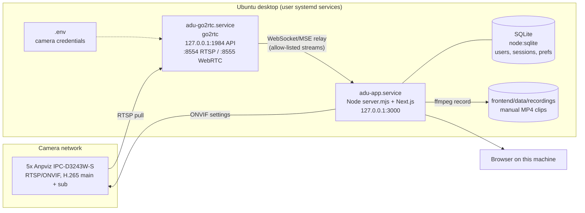

### Production stack (v1, per docker-compose.yml)

`deploy/adu.service` checks the surveillance HDD mount before starting Compose,
so containers never write recordings to the OS disk. Remote access uses
Tailscale Serve in front of the app (see [deployment.md](deployment.md)).

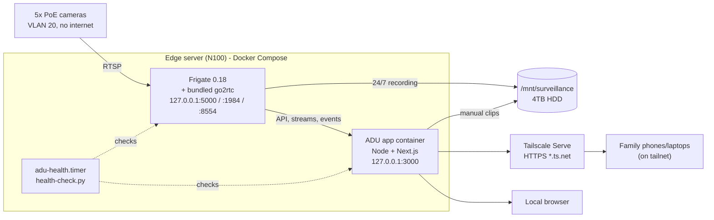

**What exists:** live grid, full-res expand, manual recording, ONVIF camera
settings, Frigate timeline/downloads, owner/viewer accounts, same-origin and
rate-limit protections, health checks.

**What is missing for home automation:** no device integration beyond cameras,
no message bus (the README mentions Mosquitto but it is not in Compose yet), no
general alert pipeline or push notifications, no TV layout, no device pairing.

## Key decision: integration hub, not custom drivers

Cameras could be integrated directly because RTSP and ONVIF are common
standards. Other home devices are not: they use Zigbee, Z-Wave, Thread/Matter,
Wi-Fi with proprietary local APIs, or vendor clouds. Writing and maintaining
those drivers would take far more effort than everything else here combined.

**Decision:** run **Home Assistant Core** headless as the device-integration
and safety-automation engine. The **ADU app stays the only user-facing UI**.
The app connects to Home Assistant server-side with a long-lived token.
Browsers never talk to Home Assistant. This is the same pattern already used
for go2rtc and Frigate.

| Option | Pros | Cons | Verdict |
|---|---|---|---|
| **A. Home Assistant as hub, ADU app as UI** | Thousands of integrations; local automations survive app restarts; Frigate integration exists; Apache-2.0 | One more service to run and update | **Chosen** |
| B. App speaks MQTT directly (Zigbee2MQTT, ESPHome, Frigate) | Fewest moving parts; full control | Only works for MQTT-native devices; every appliance/lock brand is custom work | Viable fallback if the device list stays all-Zigbee/ESPHome |
| C. Home Assistant dashboards as the UI | Zero UI work | Breaks "one app", our auth/roles, our camera UX and TV layout | Rejected |

Our UI depends on our own device model, not on Home Assistant entity names.
That keeps option B open as a later migration path.

## Target architecture

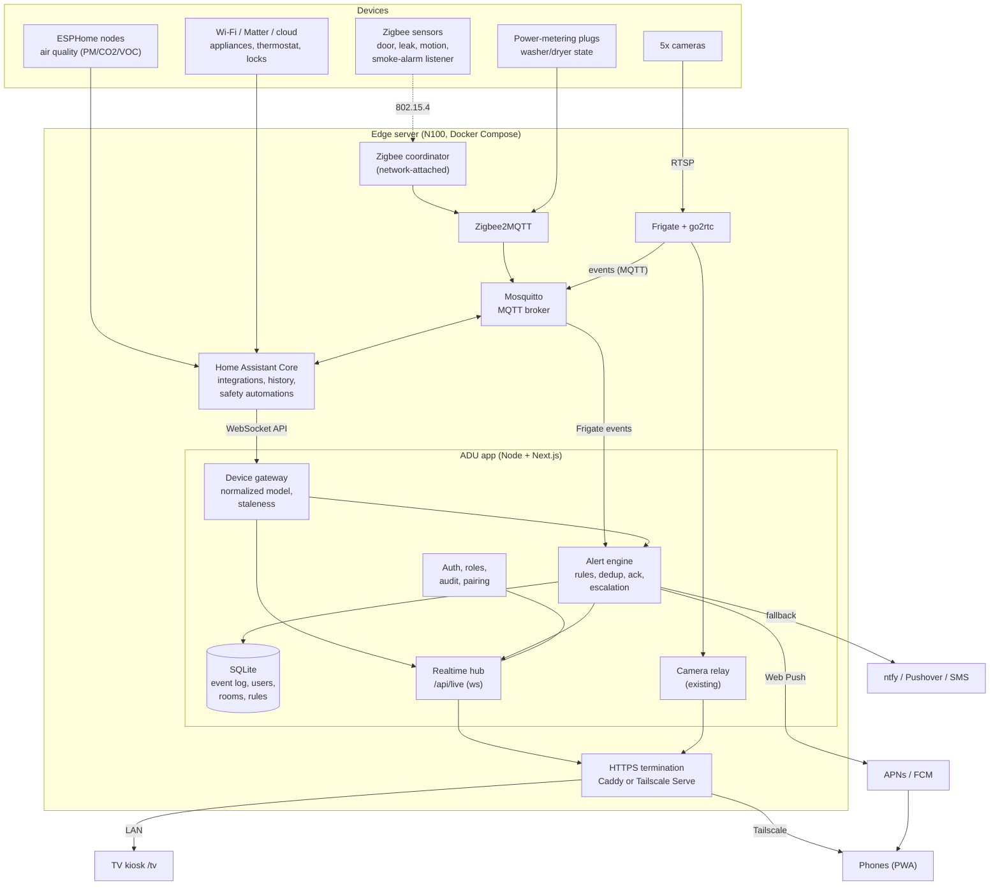

### Responsibilities

| Component | Owns | Does not own |
|---|---|---|
| Zigbee2MQTT / ESPHome | Talking to radios and DIY sensors, publishing state | Any UI or alert logic |
| Mosquitto | Message transport between device bridges, Frigate and Home Assistant | Persistence of history |
| Home Assistant | Integrations, entity history, **local safety automations** (e.g. leak → close valve) | Family-facing UI, user accounts |
| Frigate | Recording, motion/object events, go2rtc streams | Device state |
| ADU app | UI, users/roles, normalized device model, alert rules & delivery, event/audit log | Device drivers |

### Event-to-alert flow

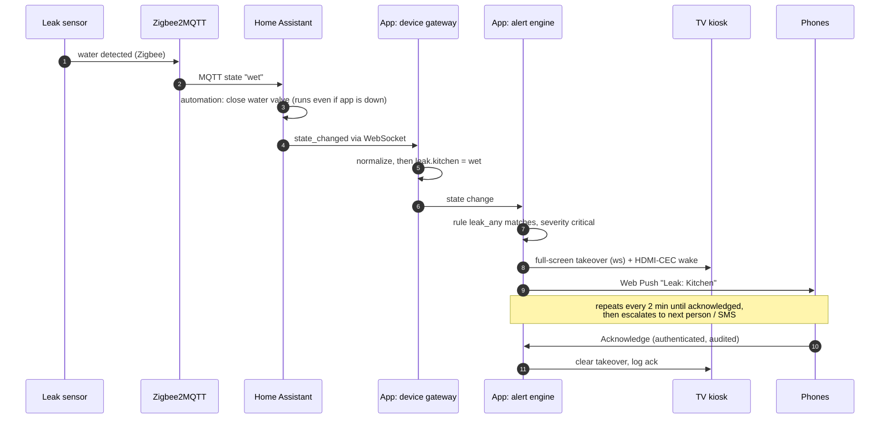

## Device layer

| Need | Recommended approach | Notes |
|---|---|---|
| Door / window status | Zigbee contact sensors via Zigbee2MQTT | Local, inexpensive, multi-year batteries |
| Door locks | Z-Wave (Z-Wave JS UI) or Matter locks via Home Assistant | Sensitive control; see [Security model](#security-model) |
| Air quality | ESPHome node with Sensirion SEN55 (PM, VOC, NOx) + SCD41 (CO2), or a commercial monitor with a local API | ESPHome is fully local |
| Water leak | Zigbee leak sensors, optional motorized shutoff valve | Valve automation lives in Home Assistant |
| Smoke / CO | **Code-listed interconnected alarms stay primary.** Add a Zigbee listener or relay module for notifications only | The app is never the only alarm path |
| Appliance status | Power-metering plugs (e.g. washer done = <5 W for 3 min), or native Home Assistant integrations | Cloud integrations are labeled "cloud" in the UI |
| Zigbee coordinator | Network-attached (Ethernet/PoE) coordinator, mounted centrally | USB 3 devices (the HDD dock) cause 2.4 GHz interference; a metal cabinet blocks the signal |

### Normalized device model

The UI and alert rules use our model, never Home Assistant entity IDs:

```js
{
  id: 'door.entry',          // stable ADU id
  kind: 'door',              // door | lock | leak | smoke | air | appliance | camera | ...
  room: 'Entry',
  state: 'open',
  since: '2026-11-08T14:02:11Z',
  battery: 82,
  stale: false,              // true when not seen within the expected interval
  source: 'ha:binary_sensor.entry_door_contact',
  local: true                // false for cloud-dependent integrations
}
```

### Device state lifecycle

Staleness is part of the model. If a door sensor's battery dies, it must show
**unknown**, not keep showing "closed".

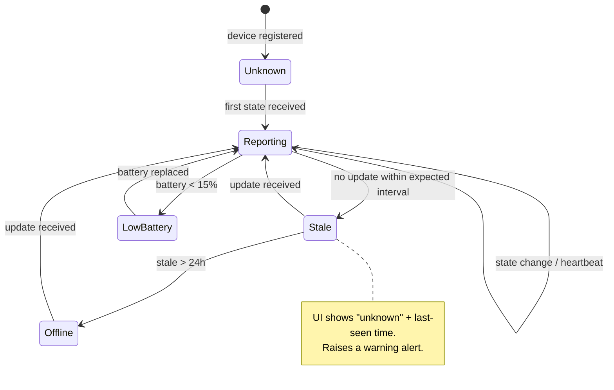

## Network segmentation

This extends the README VLAN plan and [firewall-matrix.md](firewall-matrix.md).
Zigbee/Z-Wave devices never touch IP. Only the coordinator and Wi-Fi IoT
devices sit on VLAN 30.

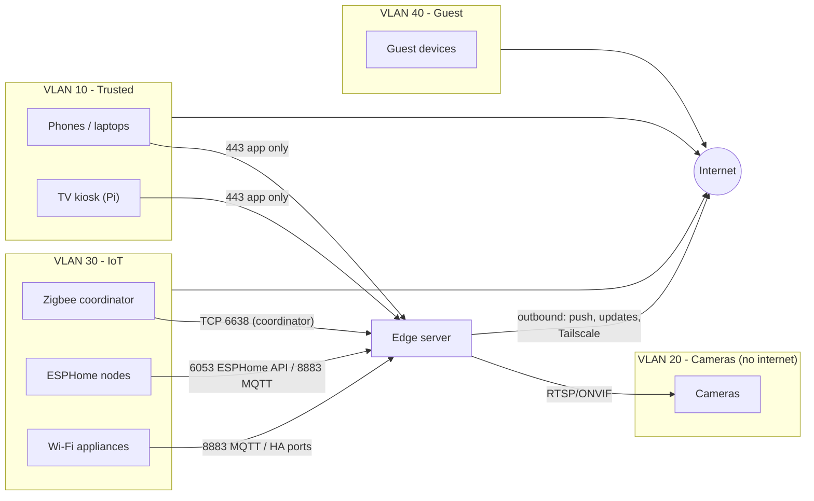

Firewall matrix additions: VLAN 30 → server on 8883 (MQTT/TLS), 6053 (ESPHome
native API) and the coordinator port. The server → VLAN 30 direction is allowed
for discovery and control. No VLAN 30 → VLAN 10 traffic is allowed.

## App backend

Keep the existing Node server (`frontend/server.mjs`) and SQLite. It already
has auth, a WebSocket relay and the camera integration, and a single home does
not need Postgres. This supersedes the FastAPI + PostgreSQL line in the README
for v2/v3. Revisit only for a multi-site product.

New server modules under `frontend/server/`:

| Module | Job |
|---|---|
| `devices.mjs` | One WebSocket connection to Home Assistant (`subscribe_entities`). Maps entities to the normalized model, tracks staleness and keeps a snapshot in memory. Room and name mapping live in SQLite |
| `live.mjs` | `/api/live` WebSocket: authenticated snapshot plus deltas to browsers, filtered by role |
| `events.mjs` | Append-only event log (SQLite WAL): state transitions, alerts, acks, control actions, actor. 90-day retention |
| `alerts.mjs` | Rule evaluation, deduplication, cooldowns, quiet hours, ack/escalation, delivery fan-out |
| `push.mjs` | Web Push subscriptions (VAPID) and fallback channels |
| `pairing.mjs` | TV/kiosk device pairing, revocable device tokens |

History: short-term state history comes from Home Assistant's recorder via its
history API. Add VictoriaMetrics or InfluxDB only if long-term air-quality or
energy charts outgrow that.

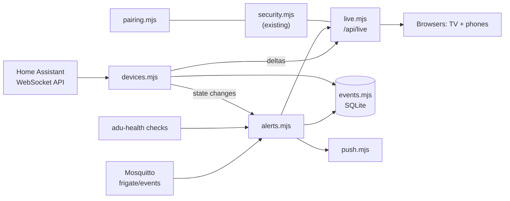

## Alerting

### Rules

Rules are stored as data (SQLite, editable in the admin UI) and evaluated on
every normalized state change:

```yaml
- id: leak_any
  when: { kind: leak, state: wet }
  severity: critical            # critical | warning | info
  notify: [push_all, tv_takeover]
  repeat_until_ack: 2m
  escalate: { after: 5m, to: [sms_owner] }

- id: door_left_open
  when: { kind: door, state: open, for: 10m }
  severity: warning
  quiet_hours: respect

- id: co2_high
  when: { kind: air, metric: co2, above: 1200, for: 15m }
  severity: info
  cooldown: 2h

- id: sensor_stale
  when: { stale: true }
  severity: warning
  cooldown: 12h
```

Frigate person events and the existing `adu-health` checks feed the same
engine. Family members get one alert inbox instead of separate NVR, health and
device notifications.

### Alert lifecycle

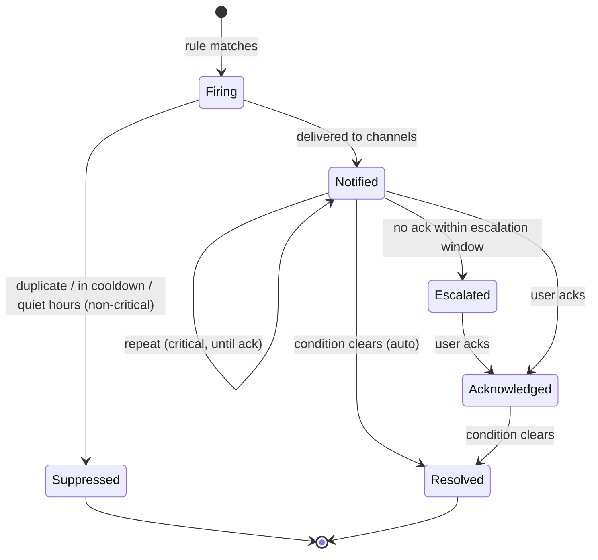

### Delivery channels

| Channel | Use | Notes |
|---|---|---|
| **Web Push** (PWA) | Primary phone channel | Payload is end-to-end encrypted (RFC 8291) and outbound-only. **Works without the phone being on Tailscale.** iOS requires the PWA to be added to the Home Screen (iOS 16.4+) |
| TV takeover | In-house | Full-screen banner plus the related camera. HDMI-CEC wakes the display |
| ntfy (self-hosted) or Pushover | Backup / critical | Pushover can bypass Do Not Disturb for critical alerts |
| SMS / email | Last-resort escalation | Also used for server-down alerts |

Privacy: push payloads carry only text ("Leak: Kitchen"). Snapshots load
inside the app over the tunnel, so no images pass through Apple or Google.

**External dead-man check:** if the server or the home internet goes down,
nothing inside the house can send an alert. The server pings an external
monitor (hosted Healthchecks.io, or Uptime Kuma on a small VPS) every minute.
That monitor alerts by SMS/email when pings stop.

## Clients: TV and phones

One Next.js app with two layouts.

| | TV / DTV monitor | Phones |
|---|---|---|
| Route | `/tv` | `/` (responsive) |
| Hardware | Raspberry Pi 5 or N100 stick running Chromium kiosk over HDMI. Avoid the TV's built-in browser | iOS / Android browsers, installed as a PWA |
| Network | VLAN 10 (or tailnet) | Tailscale (VPN On Demand on iOS), LAN at home |
| Auth | Device pairing → read-only `kiosk` token | Password (+ passkeys later), step-up for sensitive controls |
| UX | 10-foot: big tiles, D-pad/arrow navigation, rotating cameras, status strip, night dimming, alert takeover | Touch: alert inbox, tiles, cameras, controls |
| Video | H.264 sub-streams (go2rtc transcodes when needed) | Sub-streams by default, main on expand |

### TV kiosk pairing

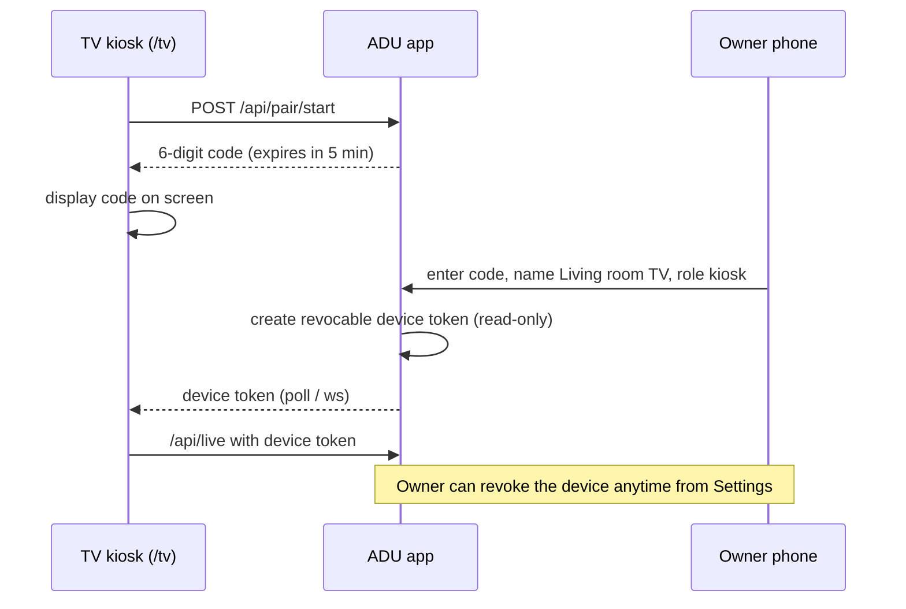

### One origin everywhere

Service workers, push subscriptions, PWA installs and cookies are all tied to
the exact origin. A phone must use **the same HTTPS URL at home and away**.

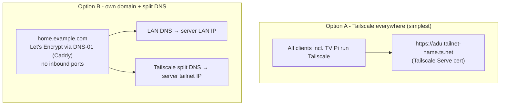

Option A matches the current deployment. Choose B if the TV or some family
devices should not run Tailscale. Retire the temporary Railway gateway
(`deploy/railway-gateway`) once either option is in place, so there is only
one remote path to secure.

## Security model

| Role | Permissions |
|---|---|
| owner | Everything, user and device management, rule editing |
| member | View all, acknowledge alerts, everyday controls (lights, plugs) |
| viewer | View only |
| kiosk | View-only dashboard on paired displays; no exports, no controls |
| guest | Time-boxed access to selected cameras/devices |

- **Sensitive controls** (unlock, garage, alarm disarm, water valve): step-up re-authentication if the session is older than 5 minutes, a confirmation dialog, and an audit log entry.
- The Home Assistant token, MQTT credentials and camera credentials stay server-side in `.env`. Home Assistant, Mosquitto (except TLS 8883 for VLAN 30) and Frigate bind to localhost.
- Existing protections stay: same-origin checks, login rate limiting, local-only owner setup.
- Add passkeys (WebAuthn), since family members on phones tend to reuse weak passwords.
- No port forwarding, and no Tailscale Funnel (unchanged rule).

## Deployment

### Target Compose stack

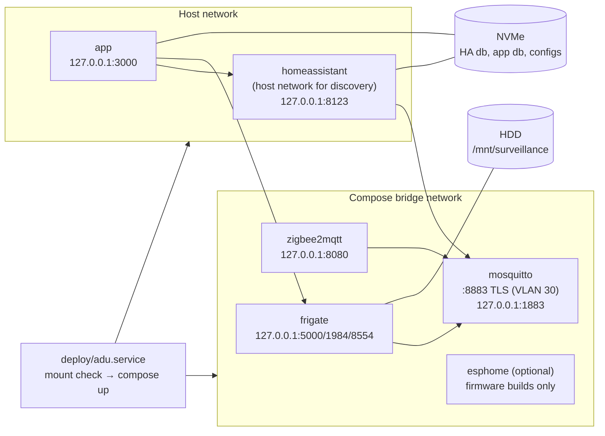

- An N100 with 16 GB RAM can run Frigate, Home Assistant, Zigbee2MQTT, Mosquitto and the app together.
- Keep the Home Assistant recorder database on the NVMe, never on the surveillance HDD.
- Pin image versions (as already done for Frigate) and update deliberately.
- Back up: `.env`, `frigate/`, the Home Assistant config, the Zigbee2MQTT `data/` (it holds the network key; losing it means re-pairing every device), and the app SQLite.
- The current user-level systemd services on the development desktop are for testing only. Production uses Compose under `deploy/adu.service`.

## Component catalog (licenses and sources)

Licenses as published by each project at the time of writing. Verify before
redistributing. **Fork/modify/link boundary:** only MIT/BSD/Apache components
may be modified or linked into a distributable image. GPL components run as
unmodified, separate processes.

### Already in use

| Component | Role | License | Open source | Source |
|---|---|---|---|---|
| go2rtc | Camera stream relay / transcoding | MIT | Yes | https://github.com/AlexxIT/go2rtc |
| Frigate | NVR: recording, events, bundled go2rtc | MIT | Yes | https://github.com/blakeblackshear/frigate |
| Node.js | App runtime (incl. built-in `node:sqlite`) | MIT | Yes | https://github.com/nodejs/node |
| Next.js | Web framework | MIT | Yes | https://github.com/vercel/next.js |
| React | UI library | MIT | Yes | https://github.com/facebook/react |
| ws | WebSocket server | MIT | Yes | https://github.com/websockets/ws |
| SQLite | App database | Public domain | Yes | https://sqlite.org (source: https://github.com/sqlite/sqlite mirror) |
| FFmpeg | Recording / probing | LGPL-2.1+ (GPL with some options) | Yes | https://github.com/FFmpeg/FFmpeg |
| Docker Engine / Compose | Containers | Apache-2.0 | Yes | https://github.com/moby/moby, https://github.com/docker/compose |
| Tailscale client | Remote access tunnel | BSD-3-Clause (client); coordination service is proprietary SaaS | Client yes | https://github.com/tailscale/tailscale |
| chrony | NTP for cameras | GPL-2.0 | Yes | https://chrony-project.org (https://gitlab.com/chrony/chrony) |

### Proposed additions

| Component | Role | License | Open source | Source |
|---|---|---|---|---|
| Home Assistant Core | Integration hub, automations, history | Apache-2.0 | Yes | https://github.com/home-assistant/core |
| Mosquitto | MQTT broker | EPL-2.0 / EDL-1.0 | Yes | https://github.com/eclipse-mosquitto/mosquitto |
| Zigbee2MQTT | Zigbee ↔ MQTT bridge | GPL-3.0 (separate process) | Yes | https://github.com/Koenkk/zigbee2mqtt |
| ESPHome | Firmware for DIY sensors (air quality) | MIT (C++ runtime) / GPL-3.0 (Python tooling) | Yes | https://github.com/esphome/esphome |
| Z-Wave JS UI | Z-Wave controller (if Z-Wave locks) | MIT | Yes | https://github.com/zwave-js/zwave-js-ui |
| Matter Server | Matter controller for Home Assistant | Apache-2.0 | Yes | https://github.com/home-assistant-libs/python-matter-server |
| Caddy | HTTPS / reverse proxy (Option B) | Apache-2.0 | Yes | https://github.com/caddyserver/caddy |
| Headscale | Self-hosted Tailscale control server (optional, removes SaaS dependency) | BSD-3-Clause | Yes | https://github.com/juanfont/headscale |
| web-push (npm) | Web Push / VAPID sending | MPL-2.0 (use unmodified) | Yes | https://github.com/web-push-libs/web-push |
| SimpleWebAuthn | Passkeys | MIT | Yes | https://github.com/MasterKale/SimpleWebAuthn |
| ntfy | Self-hosted push fallback | Apache-2.0 / GPL-2.0 dual | Yes | https://github.com/binwiederhier/ntfy |
| Pushover | Critical-alert push fallback | Proprietary SaaS (one-time app fee) | No | https://pushover.net |
| Uptime Kuma | Service monitoring / external dead-man | MIT | Yes | https://github.com/louislam/uptime-kuma |
| Healthchecks | Dead-man ping monitor (hosted or self-hosted) | BSD-3-Clause | Yes | https://github.com/healthchecks/healthchecks (hosted: https://healthchecks.io) |
| VictoriaMetrics | Long-term metrics (optional) | Apache-2.0 | Yes | https://github.com/VictoriaMetrics/VictoriaMetrics |
| smartmontools | Disk health | GPL-2.0 | Yes | https://github.com/smartmontools/smartmontools |
| Network UPS Tools (NUT) | UPS monitoring / clean shutdown | GPL-2.0+ | Yes | https://github.com/networkupstools/nut |
| restic | Encrypted off-site backup | BSD-2-Clause | Yes | https://github.com/restic/restic |
| OpenVINO | Object detection acceleration (v3) | Apache-2.0 | Yes | https://github.com/openvinotoolkit/openvino |
| Chromium | TV kiosk browser | BSD-3-Clause | Yes | https://chromium.googlesource.com/chromium/src |
| libcec (`cec-client`) | HDMI-CEC TV wake/input switch | GPL-2.0 | Yes | https://github.com/Pulse-Eight/libcec |
| Raspberry Pi OS | TV kiosk OS | Mixed open source + proprietary firmware | Mostly | https://www.raspberrypi.com/software/ |

### Hardware and firmware notes

| Item | Openness | Where |
|---|---|---|
| Zigbee coordinator (e.g. SMLIGHT SLZB-06 family, Sonoff ZBDongle-E/P) | Hardware proprietary; radio firmware is vendor SDK based (Silicon Labs EmberZNet / TI Z-Stack); Zigbee2MQTT supports both | Vendor stores; firmware: https://github.com/Koenkk/Z-Stack-firmware, https://github.com/darkxst/silabs-firmware-builder |
| Zigbee sensors (Aqara, Sonoff, IKEA, Third Reality, ...) | Proprietary devices on the open Zigbee 3.0 standard | Check https://www.zigbee2mqtt.io/supported-devices/ before buying |
| ESP32 boards + Sensirion SEN55 / SCD41 | Open firmware (ESPHome); proprietary sensors | Electronics retailers; ESPHome device docs |
| Smoke / CO alarms | Proprietary, code-listed (UL 217 / UL 2034) | Must meet local code; integration is listen-only |

## Roadmap

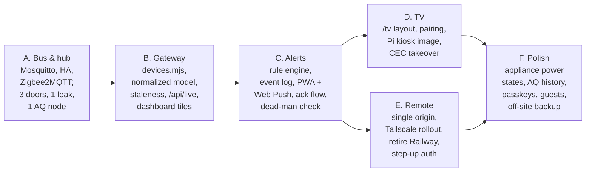

| Phase | Done when |
|---|---|
| A | Sensors visible and reliable in Home Assistant for 1 week; Zigbee2MQTT `data/` backed up |
| B | Dashboard shows doors, air and appliances live; an unplugged sensor turns "unknown" within its interval |
| C | Leak test triggers phone push within 5 s on cellular; ack stops repeats; server-off triggers external alert |
| D | TV boots straight to dashboard, needs no keyboard, and wakes on critical alert |
| E | Same URL works at home and on cellular; Railway gateway removed; unlock requires step-up |
| F | Per-phase acceptance as features land |

## Open questions

1. **Existing devices:** which appliances, locks, thermostats or monitors are already owned? A large Wi-Fi/cloud footprint strengthens the Home Assistant choice; an all-new purchase could stay Zigbee/ESPHome-only.
2. **Phones:** iOS, Android or mixed? iOS needs the Home Screen install for Web Push.
3. **TV:** dumb HDMI monitor (→ Pi kiosk) or a smart TV (Fire TV / Android TV / Tizen) that could run a kiosk app directly?
4. **Remote control of locks/garage:** wanted? If yes, step-up auth in phase E is required, not optional.
5. **Origin strategy:** Option A (Tailscale everywhere) or Option B (own domain + split DNS)?
